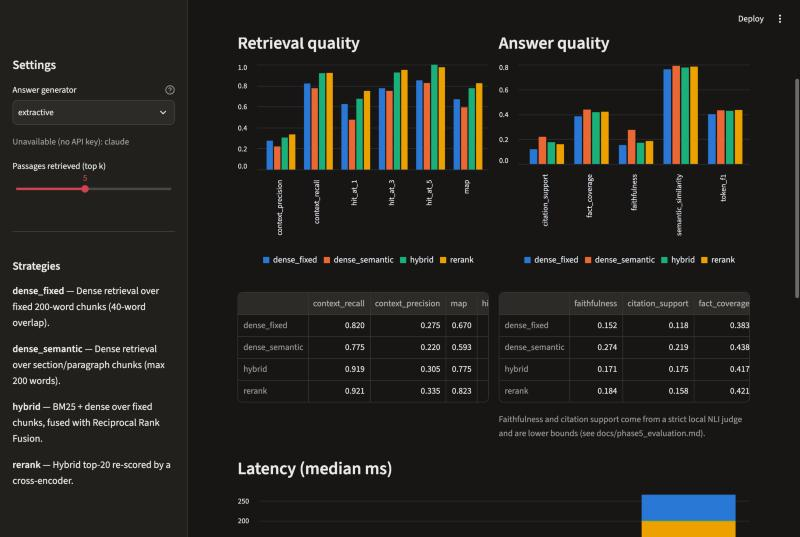
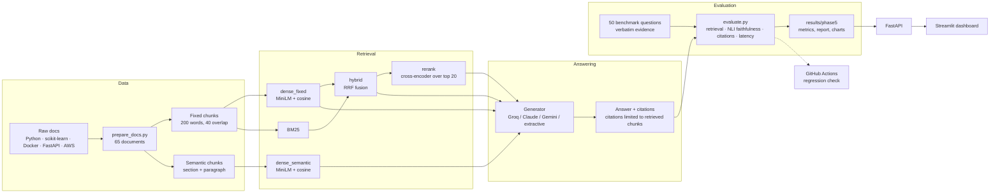
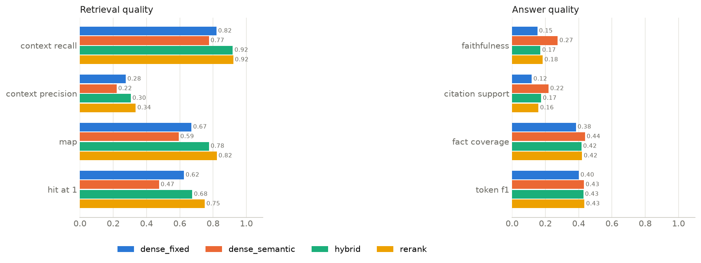
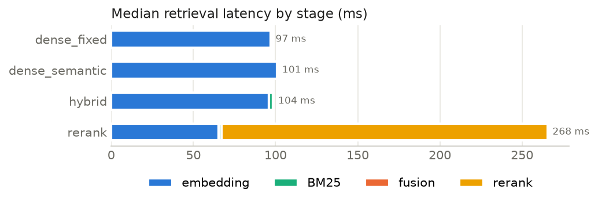
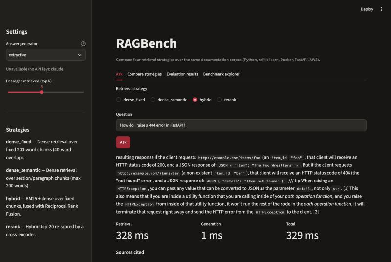

# RAGBench — an evaluation framework for RAG retrieval strategies

RAGBench measures how the **retrieval strategy** of a Retrieval-Augmented Generation (RAG) system changes what it retrieves, what it answers, whether it can back its answers with citations, and how long it takes. It runs four strategies over the same documentation corpus and the same 50-question benchmark, and reports every number from an actual run.

**Why a framework, not another RAG chatbot.** A chatbot shows that one pipeline can answer questions. RAGBench answers a different question: *which retrieval design should you choose, and what do you trade off?* It holds everything else fixed (corpus, questions, prompt, generator, top-k) and varies only retrieval, then scores the results against verified evidence. The FastAPI backend and Streamlit dashboard exist to inspect and compare those results, not as the product itself.

**Live demo:** [ragbench-dashboard-c1ab.onrender.com](https://ragbench-dashboard-c1ab.onrender.com) (dashboard) · [API docs](https://ragbench-api-83p9.onrender.com/docs). Hosted on Render's free plan: the first visit after 15 idle minutes takes about a minute to wake up, and `rerank` is turned off there because it does not fit in 512 MB (its benchmark results are in the dashboard).



## Contents

- [Problem](#problem) · [Architecture](#architecture) · [The four strategies](#the-four-strategies)
- [Corpus and benchmark](#corpus-and-benchmark) · [Evaluation method](#evaluation-method) · [Results](#results)
- [Example questions and answers](#example-questions-and-answers) · [Setup](#setup) · [Running the demo](#running-the-demo)
- [Environment variables](#environment-variables) · [Testing and CI](#testing-and-ci) · [Limitations](#limitations)
- [Project status](#project-status) · [Phase 1 dataset, provenance and licences](#phase-1-documentation-dataset)

## Problem

RAG answers are only as good as the passages retrieved. Teams choose between chunking schemes, dense vs. keyword search, fusion and reranking, usually by intuition. These choices affect accuracy, groundedness and latency in different directions, and the effects are rarely measured on the same data. RAGBench makes them measurable on a fixed, verifiable benchmark.

## Architecture



| Module | Responsibility |
|---|---|
| `src/ragbench/corpus.py`, `chunking.py` | Load the corpus; fixed and semantic chunking |
| `embeddings.py`, `vectorstore.py` | MiniLM embeddings; exact NumPy cosine search |
| `retrieval.py` | Dense, BM25, Reciprocal Rank Fusion, cross-encoder reranking |
| `generation.py`, `llm.py` | Prompt and citation contract; extractive, Groq, Gemini, Claude generators |
| `pipeline.py` | Retriever → generator, citation guarding, per-stage timings |
| `evaluation.py` | Phase 5 metrics |
| `service.py`, `api/`, `dashboard/` | Application layer |

## The four strategies

| Strategy | Chunks | How it retrieves | Why include it |
|---|---|---|---|
| `dense_fixed` | 972 fixed 200-word chunks, 40-word overlap | `all-MiniLM-L6-v2` embeddings, cosine similarity | The standard baseline |
| `dense_semantic` | 1,268 chunks that never cross a heading (≤ 200 words) | Same embeddings | Tests whether respecting document structure helps |
| `hybrid` | Fixed chunks | BM25 (k1 1.5, b 0.75) + dense, top 20 each, fused with Reciprocal Rank Fusion (k 60) | Recovers exact terms (API names, flags) that embeddings blur |
| `rerank` | Fixed chunks | Hybrid top 20 re-scored by `cross-encoder/ms-marco-MiniLM-L6-v2` | Tests whether a slower, more precise scorer improves the order |

All strategies return the top 5 passages to the same generator with the same prompt. The prompt requires citations as passage numbers and an exact abstention sentence when the passages do not contain the answer. Citations to passages that were not retrieved are dropped.

## Corpus and benchmark

- **Corpus:** 65 official documentation pages (152,638 words) from Python, scikit-learn, Docker, FastAPI and AWS (IAM, S3, EC2, Lambda), converted to Markdown. Details, provenance and licences are [below](#phase-1-documentation-dataset).
- **Benchmark:** 50 hand-verified questions, 10 per source, 2 each of direct factual, conceptual, how-to, multi-section and unanswerable (`evaluation/datasets/benchmark_questions.jsonl`). Every answerable question records the document, section, URL and a **verbatim evidence excerpt**; unanswerable questions were checked against all 65 documents. See [docs/phase2_benchmark_questions.md](docs/phase2_benchmark_questions.md).

## Evaluation method

Full definitions: [docs/phase5_evaluation.md](docs/phase5_evaluation.md). In short:

| Dimension | Metrics |
|---|---|
| Retrieval | Context recall (share of evidence text retrieved), context precision, MAP, Hit@1/3/5 (a retrieved chunk contains the evidence) |
| Answer correctness | Fact coverage (expected-answer sentences entailed by the answer, NLI), token F1, semantic similarity |
| Faithfulness | Share of answer claims entailed by a retrieved passage (NLI) |
| Citation support | Share of cited claims entailed by the passages they cite |
| Abstention | Unanswerable questions declined; answerable questions wrongly declined |
| Latency | Median and p95 per stage: embedding, BM25, fusion, reranking, generation, total |

Grading is offline and repeatable: `cross-encoder/nli-deberta-v3-base` for entailment and MiniLM for similarity. Answers were generated by Groq `openai/gpt-oss-120b` at temperature 0.

## Results

From `results/phase5/` (Groq run, 40 answerable + 10 unanswerable questions, top 5):

| Strategy | Context recall | Hit@1 | Hit@5 | MAP | Faithfulness* | Citation support* | Fact coverage | Unanswerable declined | Retrieval ms (median) |
|---|---:|---:|---:|---:|---:|---:|---:|---:|---:|
| dense_fixed | 0.820 | 0.625 | 0.850 | 0.670 | 0.152 | 0.118 | 0.383 | 10/10 | 97 |
| dense_semantic | 0.775 | 0.475 | 0.825 | 0.593 | 0.274 | 0.219 | 0.438 | 10/10 | 101 |
| hybrid | 0.919 | 0.675 | **1.000** | 0.775 | 0.171 | 0.175 | 0.417 | 10/10 | 104 |
| rerank | **0.921** | **0.750** | 0.975 | **0.823** | 0.184 | 0.158 | 0.421 | 10/10 | 268 |

\*Strict lower bounds: the local NLI judge rejects correct claims that are reworded (a spot-check found about 3 of 10 "unsupported" claims were in fact supported). Use them to compare strategies, not as hallucination rates.




**Findings** (50 questions, one model, one run; one or two questions' difference is within noise):

- **`hybrid` is the best default.** It retrieved evidence for all 40 answerable questions at almost the cost of dense search (+7 ms). BM25 rescued the six questions dense retrieval missed, which hinge on exact names.
- **`rerank` orders best but adds about 165 ms** and did not improve answers over `hybrid`. It can crowd out evidence: on AWS-MULTI-02 it filled four of five slots from one page. Use it when only one or two passages can be shown.
- **`dense_semantic` is cheapest** (about 30% fewer input tokens) but retrieves worst at rank 1, and caused the only wrong abstention (DK-DIR-02, where no evidence was retrieved).
- **Multi-section questions are hardest** for every strategy (context recall 0.67–0.78).
- **Abstention is reliable with an LLM:** all strategies declined all 10 unanswerable questions. A retrieval-score threshold could not have done this, because some unanswerable questions score higher than answerable ones.

Failure examples and the full analysis are in [docs/phase5_evaluation.md](docs/phase5_evaluation.md).

## Example questions and answers

Saved answers from the Groq run with the `hybrid` strategy (`results/phase4_groq/hybrid/run.jsonl`):

**Direct factual — PY-DIR-01:** *By default, what encoding does Python assume for source files?*
> Python assumes UTF‑8 encoding for source files by default【2】.

Cited: *Using the Python Interpreter* (chunk covering "Source Code Encoding").

**How-to — DK-HOW-02:** *How do you start a multi-container application defined in compose.yaml and then tear it down, including its volumes?*
> To launch the stack, run Docker Compose in the directory that contains the `compose.yml` file: `docker compose up -d --build` … This creates the network and starts all services defined in the file [3]. When you're finished … `docker compose down --volumes`. The `down` command removes the containers and network, and the `--volumes` flag tells Compose to remove the associated volumes as well [2].

Cited: *Multi-container applications — Run the containers*; *What is Docker Compose? — Start the application*.

**Unanswerable — PY-UNANS-01:** *How does the Global Interpreter Lock (GIL) limit multithreaded performance in CPython, and how can it be disabled in a free-threaded build?*
> The available documentation does not contain the answer to this question.



*The screenshot uses the offline extractive generator, which quotes retrieved passages instead of writing an answer.*

## Setup

Requires Python 3.11+. Developed on an 8 GB Apple Silicon Mac; all models are small (MiniLM, MiniLM cross-encoder, DeBERTa-v3-base NLI) and run on CPU.

```bash
python -m venv .venv && source .venv/bin/activate
pip install -e ".[dev]"
python scripts/build_index.py --chunking fixed       # downloads MiniLM once
python scripts/build_index.py --chunking semantic
```

Reproduce the results:

```bash
python scripts/run_strategies.py                      # offline extractive -> results/phase4/
python scripts/run_strategies.py --generator groq     # needs GROQ_API_KEY -> results/phase4_groq/ (resumable)
python scripts/evaluate.py                            # offline grading -> results/phase5/
```

## Running the demo

**Locally** (two terminals):

```bash
uvicorn api.main:app                  # API, docs at http://127.0.0.1:8000/docs
streamlit run dashboard/app.py        # dashboard at http://localhost:8501
```

**On Render (free):** `render.yaml` deploys the API and dashboard as two free services; see [docs/render_deployment.md](docs/render_deployment.md).

**With Docker** (untested: Docker was not available on the development machine):

```bash
cp .env.example .env                  # optional: add GROQ_API_KEY
docker compose up --build             # API :8000, dashboard :8501
```

The dashboard has four tabs: **Ask** (one strategy, answer with sources, retrieved passages and timings), **Compare strategies** (same question, all four side by side), **Evaluation results** (Phase 5 metrics and latency) and **Benchmark explorer** (each benchmark question with its expected answer, evidence, saved answer and scores). See [docs/phase6_application.md](docs/phase6_application.md) and [docs/phase8_deployment.md](docs/phase8_deployment.md).

## Environment variables

| Variable | Used for | Required |
|---|---|---|
| `GROQ_API_KEY` | Groq generator (`openai/gpt-oss-120b`) | Only for Groq answers |
| `GEMINI_API_KEY` | Gemini generator (`gemini-flash-latest`) | Only for Gemini |
| `ANTHROPIC_API_KEY` | Claude generator (`claude-haiku-5-5`) | Only for Claude |
| `RAGBENCH_API_URL` | Where the dashboard finds the API (default `http://127.0.0.1:8000`) | No |

Keys are read from the environment only; nothing is stored in the repository. Without any key, the offline extractive generator is used. Set keys in the shell that runs the API (or in `.env` for Docker), never in code.

## Testing and CI

```bash
ruff check . && ruff format --check .
pytest -q                                             # 64 tests
python scripts/run_strategies.py --out /tmp/rb --force && python scripts/check_regression.py /tmp/rb
```

GitHub Actions (`.github/workflows/ci.yml`) runs lint, dataset validation, tests and a retrieval regression check against `evaluation/regression_baseline.json` on every push and pull request, with no API keys. A separate manual workflow runs the full Groq evaluation. See [docs/phase7_ci.md](docs/phase7_ci.md).

## Limitations

- **Small benchmark:** 50 questions (40 answerable). One or two questions change a score by 0.025–0.05; there are no confidence intervals.
- **One generator, one run:** results are for Groq `openai/gpt-oss-120b` at temperature 0. Claude and Gemini are integrated but have no completed run.
- **Answer metrics are proxies:** the NLI judge is strict, token F1 rewards wording overlap. Absolute correctness would need an LLM judge or human grading.
- **Relevance from verbatim evidence:** a passage that supports the answer with different wording counts as not relevant.
- **Latency:** retrieval was measured on a laptop CPU; generation latency includes free-tier rate-limit waits.
- **Corpus:** 65 pages of English documentation, not full API references; snapshot revisions are not all pinned (see below).
- **Application:** no authentication or rate limiting; intended for local demos. The Docker setup is untested.

## Project status

All eight phases are implemented and documented; each was reviewed and approved before the next.

| Phase | Document |
|---|---|
| 1 — Documentation collection | [docs/phase1_collection_notes.md](docs/phase1_collection_notes.md) |
| 2 — 50-question benchmark | [docs/phase2_benchmark_questions.md](docs/phase2_benchmark_questions.md) |
| 3 — Baseline pipeline | [docs/phase3_baseline_pipeline.md](docs/phase3_baseline_pipeline.md) |
| 4 — Four strategies + LLM generators | [docs/phase4_retrieval_strategies.md](docs/phase4_retrieval_strategies.md) |
| 5 — Evaluation | [docs/phase5_evaluation.md](docs/phase5_evaluation.md) |
| 6 — API and dashboard | [docs/phase6_application.md](docs/phase6_application.md) |
| 7 — CI and regression checks | [docs/phase7_ci.md](docs/phase7_ci.md) |
| 8 — Documentation and deployment | [docs/phase8_deployment.md](docs/phase8_deployment.md) |

---

## Phase 1 Documentation Dataset

### Why These Sources Were Selected

1. **Python (`docs.python.org/3/`):** Core language fundamentals, data structures, OOP, standard library, and exception handling.
2. **Scikit-learn (`scikit-learn.org/stable/`):** Classical machine learning algorithms, preprocessing, pipelines, model selection, and evaluation metrics.
3. **Docker (`docs.docker.com/`):** Containerization, Dockerfile specifications, multi-stage builds, networking, storage, and Compose.
4. **FastAPI (`fastapi.tiangolo.com/`):** Modern API development, request validation, dependency injection, security, and asynchronous background tasks.
5. **AWS (`docs.aws.amazon.com/`):** Cloud infrastructure across four critical services: IAM, Amazon S3, Amazon EC2, and AWS Lambda.

### Dataset Summary

- **Collection Date:** November 2026 (UTC)
- **Total Processed Documents:** 65 pages
- **Total Corpus Word Count:** 152,638 words
- **Processed JSONL Size:** 1,244,227 bytes (~1.24 MB)
- **Chunking Status:** Unchunked (1 document = 1 complete official documentation page)

| Documentation Source | Repository Branch Snapshot | Content Revision | License Verification Revision | License | Pages Collected | Total Words |
| :--- | :--- | :---: | :---: | :--- | :---: | :---: |
| **Python** | `cpython` (`main` branch) | `unknown`* | `0d3ab6f` | PSF-2.0 | 12 | 34,626 |
| **Scikit-learn** | `scikit-learn` (`main` branch) | `unknown`* | `d5a61d1` | BSD-3-Clause | 14 | 56,827 |
| **Docker** | `docker/docs` (`main` branch) | `unknown`** | `4937e25` | Apache-2.0 | 13 | 15,719 |
| **FastAPI** | `fastapi` (`master` branch) | `unknown`* | `80d475b` | MIT | 14 | 17,208 |
| **AWS** (IAM, S3, EC2, Lambda) | `docs.aws.amazon.com` (HTML) | `N/A` | `N/A` | CC-BY-SA-4.0 (docs) / MIT-0 (code) | 12 | 28,258 |
| **Total** | | | | | **65** | **152,638** |

*\*Note on Content Revision:* Files were downloaded via HTTP directly from raw branch endpoints without pinning an immutable commit SHA at fetch time; exact collection commit is recorded as `unknown` rather than assumed.  
*\*\*Note on Docker:* Candidate hash `a342371cfda92b772c57a9099859f7b19cecd315` was verified locally via Git against `docker/docs.git` and confirmed NOT to be a valid ref/object; original collection revision is recorded as `unknown`, while repository root `LICENSE` at commit `4937e25` was inspected and verified as Apache-2.0.

### Version Metadata Clarifications

- **Python:** The CPython repository default branch `main` tracks development towards Python 3.14. The tutorial documentation collected from `Doc/tutorial/` covers language fundamentals identical to the current stable Python 3.12/3.13 documentation published at `docs.python.org/3/`.
- **Scikit-learn:** The Scikit-learn repository default branch `main` tracks in-development releases (1.6/1.7 dev). The user guide chapters collected from `doc/` match the algorithms, preprocessing, and evaluation workflows documented in the current stable User Guide at `scikit-learn.org/stable/`.
- **FastAPI:** The default branch is `master`, which directly drives the deployed official documentation at `fastapi.tiangolo.com`. The collected pages represent the official English documentation for FastAPI 0.115+.
- **Docker:** The default branch is `main`, tracking the live documentation published at `docs.docker.com`.

### Directory Locations

- **Raw Documents:** `data/raw/<source_name>/` (contains original `.md`, `.rst`, `.html`, and license files).
- **Source Manifest:** `data/raw/source_manifest.json` (records provenance, repository URLs, commit SHAs, licenses, and collection metadata).
- **Processed Dataset:** `data/processed/documents.jsonl` (unified JSON Lines file containing structured documents).
- **Corpus Manifest:** `data/processed/corpus_manifest.json` (verified dataset statistics, word counts, and validation status).
- **Collection Notes:** `docs/phase1_collection_notes.md` (in-depth rationale, page mappings, and conversion details).

### How to Regenerate the Processed Dataset

The preparation script uses only Python standard-library modules and processes the raw files locally with zero network access:

```bash
python scripts/prepare_docs.py
```

Running this command is completely deterministic and reproduces the exact dataset and SHA-256 hashes.

### Dataset Limitations

- **Scope:** Restricted to selected core conceptual and tutorial topics (10–15 pages per source) rather than complete exhaustive API reference libraries.
- **Language:** English documentation only.
- **Formats:** Converted from diverse source formats (Markdown, reStructuredText, HTML) into normalized GitHub-flavored Markdown. Navigation elements and boilerplate have been filtered out, but diagrams and images are represented by text references.

### Source Attribution, Licenses & Compliance

- **Python:** Python Software Foundation License Version 2 (PSF-2.0). Copyright © 2001–2026 Python Software Foundation.
- **Scikit-learn:** BSD 3-Clause License. Copyright © 2007–2026 scikit-learn developers.
- **Docker:** Apache License Version 2.0 (Apache-2.0). Copyright © 2016 Docker, Inc. Verified via Git clone at verified commit `4937e25`: Section 1 explicitly defines "Source" form to include "documentation source and configuration files", and Section 2 grants copyright license for the Work across both documentation source files and code examples.
- **FastAPI:** MIT License. Copyright © 2018–2026 Sebastián Ramírez.
- **AWS:** Documentation content licensed under Creative Commons Attribution-ShareAlike 4.0 International (CC-BY-SA-4.0); sample code / code examples licensed under MIT No Attribution (MIT-0). Copyright © Amazon Web Services, Inc. or its affiliates.
  - *Technical Method vs. Legal Determination (AWS Site Terms):* Collection was conducted via a targeted, low-volume HTTP retrieval of 12 specific conceptual HTML pages across IAM, S3, EC2, and Lambda with an identified User-Agent (`RAGBench-Collector/1.0`) and inter-request delay intervals designed to minimize server impact. This technical practice is distinct from a legal determination that the collection complied with AWS Site Terms (e.g., Section 3 "Site Access and Content"). RAGBench makes no claim of explicit authorization, license waiver, or guaranteed legal compliance under AWS Site Terms. Users are responsible for evaluating their own compliance.
