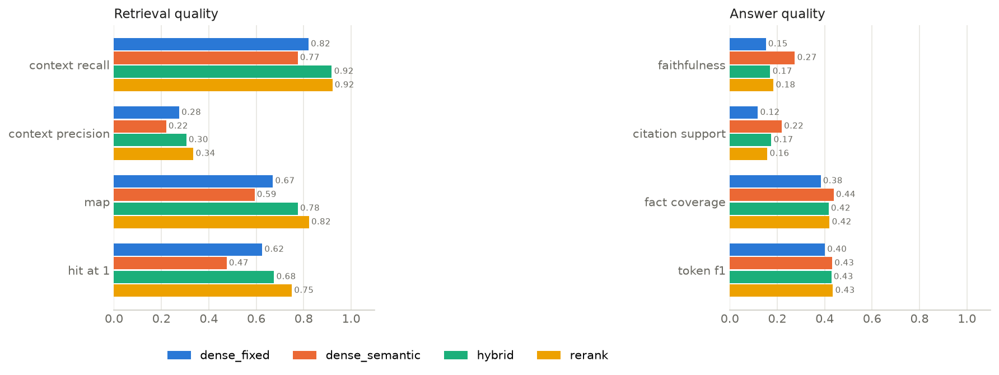
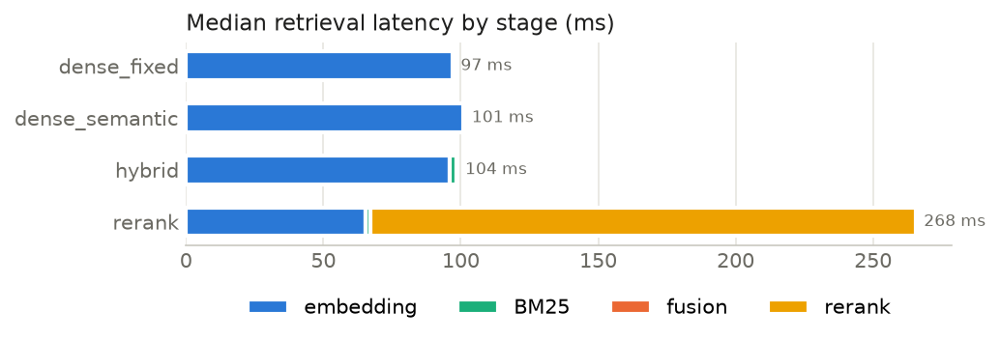

# Phase 5 — Evaluation and Comparison

Status: complete, awaiting approval (2026-11-07).

Every number below comes from `results/phase5/` (`metrics.json`, `report.md`,
per-question `*/eval.jsonl`), produced by:

```bash
python scripts/evaluate.py          # reads results/phase4_groq, writes results/phase5
```

The evaluation is offline: no API calls. It grades the completed Groq run
(`openai/gpt-oss-120b`, temperature 0, 4 strategies × 50 questions, see Phase 4 §8).

## 1. Method

| Metric | Definition |
|---|---|
| Context recall | For each evidence excerpt of a question: share of its word 3-grams present in the top-5 retrieved chunks. Averaged over excerpts, then questions. |
| Evidence fully retrieved | Share of evidence excerpts with ≥ 80% of their 3-grams retrieved. |
| Context precision | Share of the top-5 chunks that are relevant. A chunk is relevant if it contains ≥ 50% of one evidence excerpt's 3-grams. |
| MAP | Mean average precision over the same relevance labels (rewards relevant chunks ranked early). |
| Hit@k | A relevant chunk is in the top k (k = 1, 3, 5). Stricter than Phase 4's document/section hit rate, because the chunk must contain the evidence text itself. |
| Faithfulness | Answer split into sentence-level claims (fenced code and fragments under 4 words removed); a claim is supported if an NLI model gives P(entailment) ≥ 0.5 with at least one retrieved chunk as premise. Score = share of supported claims. |
| Citation support | Among claims carrying a citation: share entailed by at least one of the chunks they cite. Citation precision: share of individual citations whose chunk entails the claim. |
| Fact coverage (correctness) | Expected answer split into sentences; share entailed by the generated answer. |
| Token F1, semantic similarity | SQuAD-style token F1 and MiniLM cosine similarity between generated and expected answer. |
| Abstention | Unanswerable questions: declined or not. Answerable: wrongly declined or not. |
| Latency | Median and p95 per stage, from the timings saved in each run. |

Models: NLI judge `cross-encoder/nli-deberta-v3-base`; similarity `sentence-transformers/all-MiniLM-L6-v2`. Retrieval metrics are computed on the 40 answerable questions; answer metrics on the answerable questions that were answered.

## 2. Results

### Retrieval (40 answerable questions, top 5)

| Strategy | Context recall | Evidence fully retrieved | Context precision | MAP | Hit@1 | Hit@3 | Hit@5 |
|---|---:|---:|---:|---:|---:|---:|---:|
| dense_fixed | 0.820 | 0.792 | 0.275 | 0.670 | 0.625 | 0.775 | 0.850 |
| dense_semantic | 0.775 | 0.757 | 0.220 | 0.593 | 0.475 | 0.750 | 0.825 |
| hybrid | 0.919 | 0.909 | 0.305 | 0.775 | 0.675 | 0.925 | **1.000** |
| rerank | **0.921** | 0.909 | **0.335** | **0.823** | **0.750** | **0.950** | 0.975 |

Context precision is low for every strategy by construction: most questions have one or two evidence excerpts, so at most one or two of the five chunks can be relevant.

### Answers

| Strategy | Answered | Faithfulness | Citation support | Citation precision | Fact coverage | Token F1 | Semantic similarity |
|---|---:|---:|---:|---:|---:|---:|---:|
| dense_fixed | 40/40 | 0.152 | 0.118 | 0.093 | 0.383 | 0.401 | 0.762 |
| dense_semantic | 39/40 | 0.274 | 0.219 | 0.185 | 0.438 | 0.432 | 0.791 |
| hybrid | 40/40 | 0.171 | 0.175 | 0.139 | 0.417 | 0.428 | 0.777 |
| rerank | 40/40 | 0.184 | 0.158 | 0.112 | 0.421 | 0.435 | 0.784 |

**Read faithfulness and citation support as strict lower bounds, not as hallucination rates.** The NLI judge accepts close paraphrases (P = 0.95–0.99 in a check) but rejects claims that reword, summarise or add framing: "The tutorial recommends using `collections.deque` to implement a queue" scored 0.04 against the passage "To implement a queue, use `collections.deque`". In a spot-check of 10 claims the judge marked unsupported (hybrid, random sample, seed 5) — done before code blocks were excluded — 4 were lines of code, about 3 were clearly supported by the retrieved text, and about 3 were uncertain, including one possibly invented detail (AWS-DIR-02, a claim that Lambda retries a timed-out init). Excluding code blocks moved the scores by at most 0.016. The judge is useful for comparing strategies on the same answers, not for absolute statements.

`dense_semantic` scores highest on faithfulness and citation support. Its chunks are shorter (section/paragraph, ≤ 200 words), so a claim and its premise are closer in length, which this judge favours; it is not evidence that its answers are more truthful.

### Unanswerable questions

All four strategies declined all 10 unanswerable questions (10/10). This is the model's decision, not a retrieval threshold, and a threshold would not have worked: the highest top-1 similarity for an unanswerable question (0.595 for `dense_fixed`, 0.648 for `dense_semantic`) is above the lowest for an answerable one (0.538), with 9–13 answerable questions at or below it. Only one answerable question was wrongly declined (DK-DIR-02, `dense_semantic`), and there the retrieved chunks contained none of the evidence (context recall 0.0): declining was the correct reaction to the context it was given.

### Latency (ms, median / p95, all 50 questions)

| Strategy | Embedding | BM25 | Rerank | Retrieval total | Generation | Total |
|---|---:|---:|---:|---:|---:|---:|
| dense_fixed | 97 / 307 | – | – | 97 / 310 | 16,414 / 17,550 | 16,574 / 17,712 |
| dense_semantic | 101 / 208 | – | – | 101 / 208 | 8,336 / 17,545 | 8,406 / 17,612 |
| hybrid | 96 / 307 | 2.5 / 10 | – | 104 / 310 | 16,095 / 17,804 | 16,291 / 18,042 |
| rerank | 65 / 112 | 1.7 / 4.1 | 198 / 209 | 268 / 314 | 15,909 / 17,650 | 16,178 / 17,922 |

Generation time is dominated by free-tier rate-limit waits (429 retries) and is not a measure of model speed. Retrieval is measured on a laptop CPU; `rerank` adds about 165–200 ms per query for the cross-encoder.

### By question type (context recall / fact coverage)

| Strategy | Conceptual | Direct factual | How-to | Multi-section |
|---|---:|---:|---:|---:|
| dense_fixed | 0.90 / 0.42 | 0.99 / 0.30 | 0.71 / 0.42 | 0.67 / 0.40 |
| dense_semantic | 0.90 / 0.57 | 0.82 / 0.39 | 0.67 / 0.42 | 0.71 / 0.38 |
| hybrid | 0.96 / 0.42 | 1.00 / 0.42 | 0.95 / 0.42 | 0.77 / 0.42 |
| rerank | 0.95 / 0.48 | 1.00 / 0.37 | 0.95 / 0.50 | 0.78 / 0.33 |

Each type has 10 questions, so one question moves a cell by 0.10.

### Charts





## 3. Failure examples

- **Dense retrieval misses keyword-heavy questions.** `dense_fixed` misses all evidence in the top 5 for 6 questions (PY-CON-01, PY-HOW-02, SK-MULTI-02, FA-HOW-01, AWS-HOW-02, AWS-MULTI-02); `dense_semantic` for 7. `hybrid` misses none: BM25 recovers exact terms such as API names.
- **Reranking can crowd out evidence.** AWS-MULTI-02 (S3 bucket policy for another account): `rerank` filled four of five slots with `aws_s3_access_control` and dropped the IAM-policy evidence `hybrid` had retrieved (context recall 0.18). The answer cited only that page.
- **Multi-section questions are hardest.** Context recall is 0.67–0.78 for every strategy, because evidence lives in several sections and five chunks rarely cover them all (e.g. SK-MULTI-02 at 0.38 even for `hybrid`).
- **Wrong abstention from missing context.** DK-DIR-02 under `dense_semantic`: no evidence retrieved, the model declined.
- **Possible invented detail.** AWS-DIR-02: one answer claim about Lambda retrying a timed-out init phase was not found in the retrieved text (spot-check, unconfirmed).
- **Gold-list strictness.** FA-DIR-01: answers cite FastAPI pages that also mention `/docs` and `/redoc`, but only the first-steps page is the gold evidence, so retrieval metrics count them as misses.

## 4. Strengths, weaknesses and recommendation

| Strategy | Strengths | Weaknesses |
|---|---|---|
| dense_fixed | Simplest; fastest retrieval; good on direct factual questions | Misses exact-term queries; lowest faithfulness/citation proxies |
| dense_semantic | Fewest input tokens (about 30% less); best NLI scores (short chunks); fastest generation in this run | Lowest retrieval quality (Hit@1 0.475); one wrong abstention |
| hybrid | Evidence in the top 5 for every question; recall 0.92; only ~7 ms more than dense | Weaker ranking at position 1 than rerank |
| rerank | Best ranking (Hit@1 0.75, MAP 0.82) and precision | ~2.6× retrieval time; can crowd out evidence from other documents (AWS-MULTI-02); no measurable answer gain over hybrid |

**Which to use when** (on this benchmark, 50 questions, one model, one run — differences of one or two questions are within noise):

- **Default: `hybrid`.** Highest coverage at nearly the cost of dense retrieval. With an LLM that reads all five passages, getting the evidence into the top 5 matters more than getting it to rank 1.
- **`rerank`** when only the top one or two passages can be shown (small context budget, UI showing a single source), and 200 ms extra is acceptable.
- **`dense_semantic`** when token cost dominates, accepting lower retrieval quality.
- **`dense_fixed`** as a baseline only.

## 5. Limitations

- Answer-quality metrics are local proxies. The NLI judge is strict (see above); token F1 and similarity reward wording overlap, not correctness. An LLM judge or human grading would be needed for absolute correctness numbers.
- One generator (`openai/gpt-oss-120b`), one run at temperature 0; no confidence intervals.
- Relevance labels come from verbatim evidence excerpts; a chunk that supports the answer with different text is counted as not relevant.
- Generation latency includes rate-limit waits.
